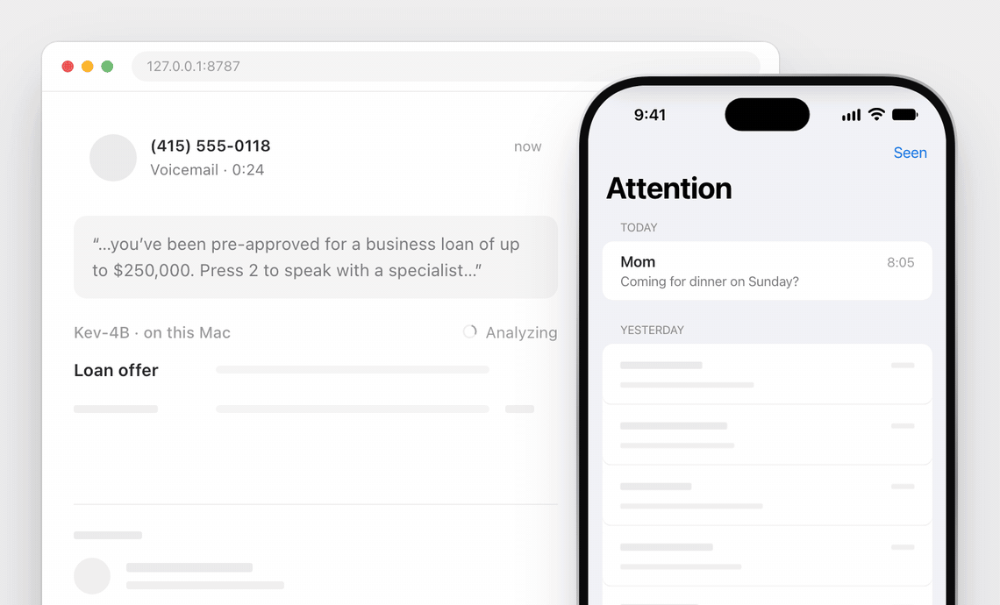
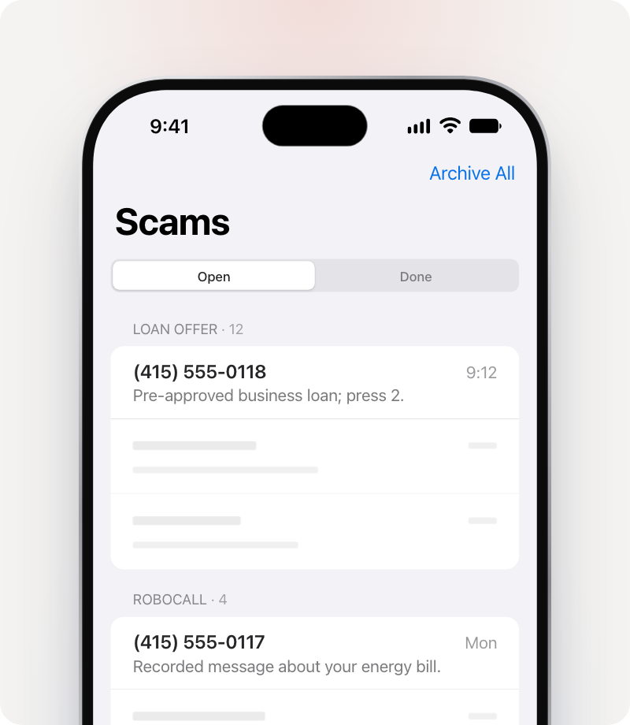

# ScamShield

**Private, automatic call screening for iPhone, decided on your own Mac.**

iOS can silence unknown callers, but it leaves you with a call log full of loan robocalls and a voicemail
list you have to listen to. ScamShield reads every missed call and voicemail on your Mac, decides what
each one is with a small local model, and sorts it for you. You only get an alert for the call that
actually needs you.

<p align="center">
  
</p>

- **Attention**: people you know, appointments, doctors, deliveries, recruiters, real callbacks. **You get an alert.**
- **Review**: uncertain calls, or callers who left no message. Silent.
- **Scams**: loan offers, robocalls, telemarketing, fraud and numbers you blocked. Silent, labelled by type.

There are no subscriptions, no cloud AI and no server. **It doesn't need a paid Apple Developer account:**
the iPhone app installs with a free Apple ID, and the Mac reinstalls it every few days before Apple's 7-day limit.

## How it works

```
iPhone call / voicemail
   │  Apple's own iCloud sync (Phone & FaceTime → Mac)
   ▼
Mac: ScamShield agent (background, starts at login)
   ├─ reads call history + voicemails (Apple's transcripts and audio; read-only snapshot copies)
   ├─ context: Contacts, Calendar, your past calls, your corrections,
   │           FCC complaint data, optional RoboKiller lookup for silent unknown callers
   ├─ Kev-4B decision model (local, MLX)   → calibrated category probabilities  (~0.4 s)
   ├─ Qwen3.5-4B writer (local, MLX)       → caller name, organization, one-line summary
   └─ explicit, unit-tested policy (mac/Sources/ScamShieldCore/Classifier.swift) → bucket
   ▼
iPhone app: pulls the inbox straight from the Mac over your Wi-Fi (Bonjour + a shared key);
            iCloud Drive is the fallback when you're away. Your corrections flow back the same way.
```

**Why a Mac?** iOS gives third-party apps no access to call history or voicemail. The only supported
place this data appears is a Mac signed in to the same Apple Account, through Phone & FaceTime sync.

**It uses a decision model, not a chatbot.** Kev-4B answers typed questions ("which category is this
voicemail?", "is the caller asking for a callback?") with probabilities. A small writer model only
produces the summary you read. It never decides where a call goes.

**The policy is code.** The safety rules are explicit and unit-tested:
- Contacts, numbers you've called and calendar matches never go to Scams.
- Anything with moderate signs of legitimacy goes to Review at worst.
- A missed call with no message goes to Review unless it is strongly reported elsewhere.

## Install

**What you need:**
- An Apple Silicon Mac with macOS 15 or later, about 11 GB of free RAM for the models, Xcode, `uv` and `xcodegen` (`brew install uv xcodegen`).
- An iPhone on the same Apple Account, with **Settings → Apps → Phone → Calls on Other Devices** turned on, so call history reaches the Mac.
- Optionally, **Silence Unknown Callers** or **Screen Unknown Callers** on the iPhone.

**1. The Mac agent and the models, once:**

```sh
./scripts/install.sh
```

The installer:
- creates a local code-signing certificate, so macOS permissions survive updates;
- builds `~/Applications/ScamShield.app`;
- installs the two model services;
- registers LaunchAgents (`com.scamshield.agent|decider|writer`) that restart on failure.

Expect these once:
- A keychain prompt to use the signing key. Enter your password and choose **Always Allow**.
- The Contacts and Calendar dialogs. Choose **Allow**.
- **System Settings → Privacy & Security → Full Disk Access → +**, then add `~/Applications/ScamShield.app`.

**2. The iPhone app:** sign in to Xcode with your Apple ID (**Settings → Accounts**), connect the iPhone by USB, then run:

```sh
./scripts/ios-install.sh            # build with your free "Personal Team" and install
./scripts/ios-install.sh --schedule # reinstall automatically before the 7-day expiry
```

On the iPhone:
1. Trust the developer: **Settings → General → VPN & Device Management**.
2. Open ScamShield and allow **Local Network** access.
3. Optionally, pick the `iCloud Drive/ScamShield` folder for away-from-home sync and corrections.

## Using it



- **Attention** shows a badge and sends alerts. **Seen** clears everything at once.
- **Review** and **Scams** never alert or badge.
- Open any item for the summary, the transcript, the voicemail audio and why it was filed there.
- **Move an item** to another list to correct it. ScamShield learns from corrections:
  - A future voicemail with the same script is filed the same way, using text similarity.
  - The organization it named gets a rule, for example "Pineview Financial" → Scams.
  - You can also set "always for this number".

  Rules only nudge within the safety floors. A claimed organization name can't send clearly
  legitimate content to Scams.

The Mac also serves a full web UI at **http://127.0.0.1:8787**.

<br clear="right">

## Configuration

Edit `~/Library/Application Support/ScamShield/config.json`, then restart with
`launchctl kickstart -k gui/$UID/com.scamshield.agent`.

| Key | Default | What it does |
|---|---|---|
| `useRoboKiller` | `true` | Looks up unknown callers who left no voicemail on RoboKiller's public page (the number only; cached 24 h, at most one request per 3 s) |
| `ftcApiKey` | none | A free [api.data.gov](https://api.data.gov/signup/) key adds FTC Do Not Call complaints. FCC data works without a key |
| `useLAN` / `lanPort` | `true` / `8790` | Direct Wi-Fi sync to the iPhone app |
| `useCloudDrive` | `true` | The iCloud Drive fallback and corrections folder |
| `useContacts`, `useCalendar` | `true` | Use these as context; they protect real callers |
| `notifyMaxAgeMinutes` | `1440` | No alerts for calls older than this |
| `thresholds` | see `Classifier.swift` | Routing thresholds |

## Operations

- **Status:** `curl -s localhost:8787/api/status`.
- **Logs:** `~/Library/Logs/ScamShield/{agent,decider,writer,setup}.log`.
- **Data:** `~/Library/Application Support/ScamShield/` (SQLite, the config and the Wi-Fi key; nothing in the repo).
- **Update:** `git pull && ./scripts/install.sh`. The app is re-signed only when its Swift source changes.
- **Uninstall:** `./scripts/uninstall.sh`. Add `--purge` to delete your data as well.
- **Battery:** the iPhone app has no timers. It refreshes when you open it and through iOS background refresh, which iOS limits to roughly every 15 minutes at most.

## Development

```sh
cd mac && swift test                                       # classifier, policy, parsing, sync (40 tests)
SCAMSHIELD_NO_PERSONAL=1 swift run ScamShieldAgent --once  # one pass without Contacts/Calendar
python3 ios/scripts/make_fixtures.py                       # synthetic inbox for the simulator
python3 web/dev/mock_server.py                             # web UI against fixtures
```

- **Sync and API contracts:** [docs/SYNC.md](docs/SYNC.md) and [docs/API.md](docs/API.md).
- **iOS project:** generated by XcodeGen from `ios/project.yml`.
- **Using Claude Code:** see [CLAUDE.md](CLAUDE.md).

## What Apple allows, and what it doesn't

| Capability | Status |
|---|---|
| Reading synced iPhone call history and voicemails (with Apple's transcripts and audio) on the Mac | Works. ScamShield reads private Apple databases from read-only copies, so a macOS update can change them |
| Local classification | Tested on a real inbox of about 150 calls and 40 voicemails: loan robocalls go to Scams, appointments and personal calls to Attention, ambiguous robocalls to Review, about 0.5 s each |
| Time from call to ScamShield | Depends on Apple's iCloud sync, which is undocumented. Calls are processed when the Mac is awake |
| Blocking numbers on the iPhone itself | Needs a paid developer account (CallKit). ScamShield files blocked callers in Scams instead |
| Deleting calls or voicemails, or marking them read, in Apple's Phone app | No supported API. ScamShield **never writes** to Apple's stores |
| Push notifications | Need a paid account. Alerts are local notifications posted when the app refreshes |

## Privacy

- **Calls, contacts and calendar never leave your Mac**, and the models run on 127.0.0.1.
- **The iPhone app gets its data from your Mac** over your local network, with a per-install shared key, or through your own iCloud Drive.
- **Complaint data is downloaded in bulk** by date range.
- **The one outbound lookup:** for an unknown caller who left no voicemail, just that number is checked on RoboKiller's public page. Turn it off with `"useRoboKiller": false`.

## Acknowledgements

ScamShield is built on other people's work. Thank you:

- **[Kev](https://github.com/jaredpalmer/kev)** by Jared Palmer (Apache-2.0). The decision model and its System One-style server. ScamShield runs the [`jaredpalmer/kev-4b`](https://huggingface.co/jaredpalmer/kev-4b) adapter.
- **[Qwen3.5](https://huggingface.co/Qwen)** by the Qwen team, Alibaba Cloud (Apache-2.0). `Qwen3.5-4B-Base` is Kev-4B's base model, and [`mlx-community/Qwen3.5-4B-MLX-4bit`](https://huggingface.co/mlx-community/Qwen3.5-4B-MLX-4bit) is the summary writer.
- **[MLX](https://github.com/ml-explore/mlx) and [mlx-lm](https://github.com/ml-explore/mlx-lm)** by Apple's ML Explore team (MIT). On-device inference.
- **The TypeSafe System One API** ([docs.typesafe.ai](https://docs.typesafe.ai)). The typed-question request format the decider speaks.
- **[FCC Consumer Complaints](https://opendata.fcc.gov/Consumer/CGB-Consumer-Complaints-Data/3xyp-aqkj)** open data, and the **[FTC Do Not Call](https://www.ftc.gov/policy-notices/open-government/data-sets/do-not-call-data)** complaint API. Reputation signals.
- **[RoboKiller](https://lookup.robokiller.com)** public number lookup pages. ScamShield is not affiliated with or endorsed by RoboKiller.
- **Stageshow** by Benji Taylor (MIT). The README animation was built with its React kit; the scene's source is in [`design/readme-hero/`](design/readme-hero/).
- **[XcodeGen](https://github.com/yonaskolb/XcodeGen)** (MIT) and **[uv](https://github.com/astral-sh/uv)** (MIT/Apache-2.0). Build tooling.

Full license texts for these are in [THIRD_PARTY_NOTICES.md](THIRD_PARTY_NOTICES.md).

## License

[MIT](LICENSE). Model weights and data sources keep their own licenses and terms (see above).
